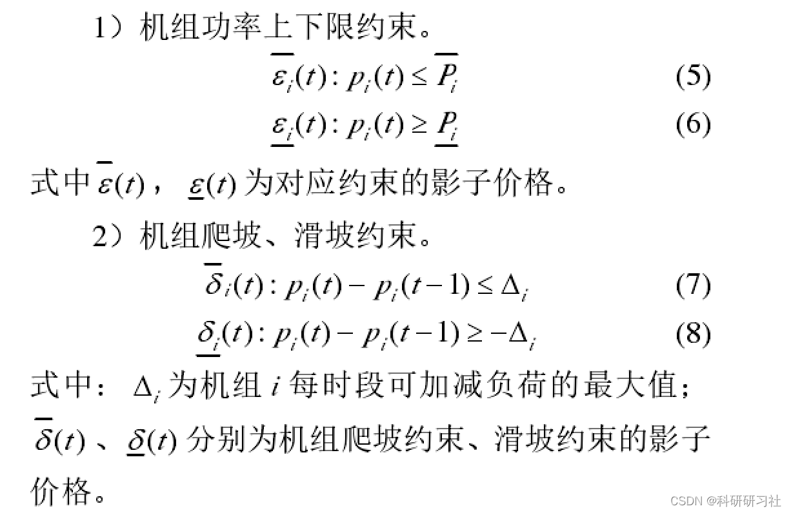
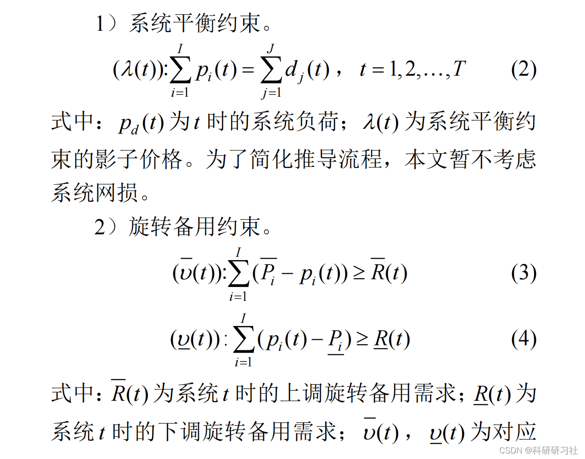
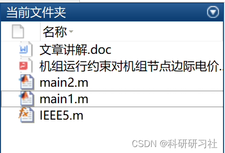

# Research on the Impact of Unit Operational Constraints on Marginal Electricity Price at Unit Node (Matlab Code Implementation)

1. Overview of spot market pricing based on node marginal electricity price (LMPP)
The value of energy in the spot market is determined by node marginal electricity prices, which can scientifically measure the value of energy. This pricing method provides economic signals to users and promotes full market competition. According to basic economic principles, under a fully competitive market environment, marginal cost pricing maximizes individual benefits while also achieving social welfare gains, promoting efficiency and encouraging competition. In scenarios where there are congestion issues [2-5], this pricing mechanism has a positive impact on system construction and is adopted by multiple pilot projects.
This paper supplements and improves the calculation formula for node marginal electricity prices considering system reserve capacity based on [22]. Based on the formulation:
2.1 Objective function
F is the generation cost based on bidding, including operational costs and startup costs;
I is the operating cost for each unit;
pi is the active power output of the unit.
2.2 Constraint conditions
3 Matlab code and detailed article explanation
This article only presents part of the code, with all codes and detailed explanations available in:
Research on the impact of unit operation constraints on node marginal electricity prices (Matlab code implementation)
Table 1 Unit physical parameters information
Unit  
Minimum output/MW  
Maximum output/MW  
Unit bidding price (CNY/MWh)  
Unit 1  
104  
520  
188  
Unit 2  
22  
110  
85  
Unit 3  
120  
600  
58  
Unit 4  
20  
100  
91  
Unit 5  
40  
200  
253  
Table 2 Line physical parameters table
Line  
Maximum transmission capacity/MW  
AB  
500  
BC  
400  
DC  
500  
AD
400  
AE  
400  
ED  
230  
Under no-block condition, load is 852MW.
Table 3: Results of Unblocked Period Units' Capacity
Unit
Unit output / MW
Is it a marginal unit?
Unit 1
104  
No
Unit 2
88  
Yes
Unit 3
600  
No
Unit 4
20  
No
Unit 5
40  
No
Table 4 Results of marginal electricity price calculation for unit nodes without blocking
Unit
Quote
lam1  
lam11  
LMP  
Unit 1
188  
0  
103  
85  
Unit 2
85  
0  
0  
85  
Unit 3
58  
27  
0  
85  
Unit 4
91  
0  
6  
85  
Unit 5
253  
0  
168  
85  
There is a blockage, yet the load remains at 852MW. However, at this time, the transmission power limit is reduced from 230 to 180, causing a line blockage.
Table 5 Results of Unit Capacity with Blocking Periods
Unit
Unit output / MW
Is it a marginal unit?
Unit 1
104  
No
Unit 2
108  
Yes
Unit 3
580  
No
Unit 4
20  
No
Unit 5
40  
No
Table 6 Results of marginal electricity price calculation for unit nodes with blockage
Unit
Quote
lam1  
lam11  
LMP  
Unit 1
188  
0  
103  
85  
Unit 2
85  
0  
0  
85  
Unit 3
58  
0  
0  
58  
Unit 4
91  
0  
6  
85  
Unit 5
253  
0  
168  
85  
Table 7 Results of LMP Calculations for Unit Nodes with Blockage
Unit  
LMP  
Unit 1  
85  
0  
85  
Unit 2  
85  
0  
85  
Unit 3  
85  
27  
58  
Unit 4  
85  
0  
85  
Unit 5  
85  
0  
85  
1) Without Blockage:
Table 8 Results of Unit Power Generation for Non-Blockage Time Period (Modified Power Lower Limit Case)
Unit  
Power Generation/MW  
Is Marginal Unit  
Unit 1  
300  
No  
Unit 2  
22  
No  
Unit 3  
470  
Yes  
Unit 4  
20  
No  
Unit 5  
40  
No  
Table 9 Results of LMP Calculations for Unit Nodes without Blockage (Modified Power Lower Limit Case)
Unit  
Pricing  
lam1  
lam11  
LMP  
Unit 1  
188  
0  
130  
58  
Unit 2  
85  
0  
27  
58  
Unit 3  
58  
0  
0  
58  
Unit 4  
91  
0  
33  
58  
Unit 5  
253  
0  
195  
58  
As shown in Table 9, by analyzing another angle, after modifying the power lower limit of Unit 1, the results of power generation for each unit have changed, causing the marginal units to change from Unit 2 to Unit 3, and at the same time, Unit 2 operates at its minimum technical output. Finally, the system marginal price becomes 58 Yuan/(MWh).
Table 10 Results of Unit Power Generation for Non-Blockage Time Period (Modified Power Upper Limit Case)
Unit  
Power Generation/MW  
Is Marginal Unit  
Unit 1  
302  
Yes  
Unit 2  
110  
No  
Unit 3  
300  
No  
Unit 4  
100  
No  
Unit 5  
40  
No
Table 11: Unblocked calculation results of marginal unit node electricity price for the modified power upper limit case (Case A)
Units  
Quoted Price  
lam1  
lam11  
LMP  
Unit 1  
188  
0  
0  
188  
Unit 2  
85  
103  
0  
188  
Unit 3  
58  
130  
0  
188  
Unit 4  
91  
91  
0  
188  
Unit 5  
253  
0  
65  
188  
As shown in Table 11, from another perspective, after modifying the power upper limit of Unit 3, the output results of various units have changed. This leads to the marginal unit changing from Unit 2 to Unit 1, while Units 2 and Unit 4 operate at their maximum technical output capacity. Consequently, the system marginal electricity price becomes 188 Yuan/(MWh).
2) With blockage  
Table 12: Marginal unit output results during blocked periods based on the modified power lower limit case (Case B)
Units  
Output per MW  
Is a marginal unit  
Unit 1  
300  
No  
Unit 2  
22  
No  
Unit 3  
470  
Yes  
Unit 4  
20  
No  
Unit 5  
40  
No  
Table 13: Marginal unit node electricity price with blockage calculation results (Modified power lower limit case)
Units  
Quoted Price  
lam1  
lam11  
LMP  
Unit 1  
188  
0  
130  
58  
Unit 2  
85  
0  
27  
58  
Unit 3  
58  
0  
0  
58  
Unit 4  
91  
0  
33  
58  
Unit 5  
253  
0  
195  
58
Based on the aforementioned case of modifying the power limit without blocking, limiting the ED transmission power, the following table is obtained.
Table 14: Results of Unit Capacity with Blocking Periods (Modified Power Limit Case)
Unit
Unit output / MW
Is it a marginal unit?
Unit 1
302  
Yes
Unit 2
110  
No
Unit 3
300  
No
Unit 4
100  
No
Unit 5
40  
No
Table 15: Marginal Electricity Price at Unit Nodes with Blockage Calculation Results (Modified Power Limit Case)
Unit
Quote
lam1  
lam11  
LMP  
Unit 1
188  
0  
0  
188  
Unit 2
85  
103  
0  
188  
Unit 3
58  
130  
0  
188  
Unit 4
91  
97  
0  
188  
Unit 5
253  
0  
65  
188  
4.3 Influence of generator set quotation on node electricity price and system marginal electricity price
1) When there is no blocking.
The quotation for the generator set 3 has been increased from 58 RMB/(MWh) to 87 RMB/(MWh), and the recalculated results are shown in the following table.
Table 16: Results of Unblocked Period Unit Capacity (Increased Unit Price)
Unit
Unit output / MW
Is it a marginal unit?
Unit 1
104  
No
Unit 2
110  
No
Unit 3
578  
Yes
Unit 4
20  
No
Unit 5
40  
No
Table 17 Results of marginal electricity price calculation for unit nodes (improved unit 3 pricing)
Unit
Quote
lam1  
lam11  
LMP  
Unit 1
188  
0  
101  
87  
Unit 2
85  
2  
0  
87  
Unit 3
58  
0  
0  
87  
Unit 4
91  
0  
4  
87  
Unit 5
253  
0  
166  
87  
As shown in Table 16 and Table 17, after the price increase for Unit 3, the marginal unit changed from Unit 2 to Unit 3. The output of Unit 2 increased, while that of Unit 3 decreased. The marginal electricity price of the system became 87 RMB/(MWh).
2) When there is a blockage.
4.4 The impact of system load increase on node electricity price and system marginal electricity price
When there is no blocking
When the system load increased from 852MW to 1200MW, the recalculated results are as follows.
Table 18 Results of Unit Capacity Outflow in Non-Blocking Periods (Increasing System Load)
Unit
Unit output / MW
Is it a marginal unit?
Unit 1
350  
Yes
Unit 2
110  
No
Unit 3
600  
No
Unit 4
100  
No
Unit 5
40  
No
Table 19: Marginal Electricity Price at Unit Nodes without Blockage (Increased System Load)
Unit
Quote
lam1  
lam11  
LMP  
Unit 1
188  
0  
0  
188  
Unit 2
85  
103  
0  
188  
Unit 3
58  
130  
0  
188  
Unit 4
91  
91  
0  
188  
Unit 5
253  
0  
65  
188  
From the above results, it can be seen that when the load increases to 1200MW, at this time, Units 2, 3, and 4 have reached their maximum technical output. At this point, the marginal unit is Unit 1, and the marginal system price is 188 RMB/(MWh).
When there is a blockage.
When the system load increased from 852MW to 1200MW, the transmission power was limited and the following table was obtained.
Table 20: Results of Unit Capacity with Blocking Periods (Increased System Load)
Unit
Unit output / MW
Is marginal unit  
Unit 1  
370  
Yes  
Unit 2  
110  
No  
Unit 3  
580  
No  
Unit 4  
100  
No  
Unit 5  
40  
No  
Table 21 Marginal electricity price at node of units (with load increase)  
Units  
Quoted price  
lam1  
lam11  
LMP  
Unit 1  
188  
0  
0  
188  
Unit 2  
85  
103  
0  
188  
Unit 3  
58  
0  
0  
58  
Unit 4  
91  
91  
0  
188  
Unit 5  
253  
0  
65  
188  
Reference [1] Shi Xinhong, Zheng Yaoxian, Xue Bike, Feng Shuhai. Analysis on the impact of operational constraints on marginal electricity prices at unit nodes [J]. Power System Technology, 2019, 43(08):2658-2665.DOI:10.13335/j.1000-3673.pst.2019.0540.

## Images

<!-- PAYMENT_BLOCK -->

## Get this dataset

- Payment link (Stripe): [Buy now](https://buy.stripe.com/3cs8yP7sY87d0vu9AB)
- Payment QR code: 

<!-- /PAYMENT_BLOCK -->
